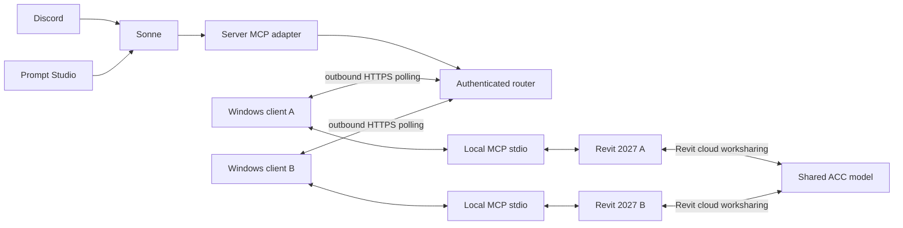

# Revit 2027: central Sonne with Windows clients

The Linux server runs Sonne and the Revit router. Each Windows workstation runs
an outbound HTTPS client, the upstream MCP stdio server and a Revit add-in.
No Revit listener is exposed to the LAN or Internet.



ACC stores and synchronizes the shared model through Revit. The live tools act on
the active document. The optional [room publication check](PUBLICATIONS.md)
reads saved RVT versions and sends a Discord alert when an area exceeds the brief
tolerance.

## MCP tools

Sonne receives eight native OpenClaw MCP tools.

- `revit__revit_sessions`: list online clients, active document IDs and names.
- `revit__revit_tools`: obtain argument schemas for a selected session; `tool`
  selects one schema without loading the entire catalog.
- `revit__revit_read`: call a read tool with a short document target ID.
- `revit__revit_edit`: set a parameter or move one inspected element.
- `revit__revit_call`: universal upstream calls, including reads and C#;
  the server determines read/write permissions automatically.
- `revit__revit_audit`: complete parameter audit with compact counts and a preview.
- `revit__revit_bulk_set`: atomic parameter update using that audit's ID.
- `revit__revit_room_publications`: read saved room schedule versions, brief checks
  and alert status when publication checks are enabled.

All 26 implemented tools in the pinned upstream server are available, plus the
two Sonne element tools and two parameter procedures (30 total). This includes family/view/selection queries, model and
material statistics, room export, creation of point/line/surface elements,
structural framing, grids, levels, rooms, dimensions, tags, view overrides,
deletion, local database storage/query and C# execution. The upstream files
`modify_element`, `search_modules` and `use_module` are empty placeholders and
do not register tools. The live catalog is authoritative.
Sonne adds `sonne_get_element` to inspect parameter IDs, raw values and an element's
anchor in millimetres, and `sonne_edit_element` for guarded parameter/position edits.
Both router and Windows client classify all installed tools. Read-only clients
receive only the eleven read tools. Every other operation requires server and client
write opt-in; C# is always classified as a write, including read-only snippets.
The inspected `revit_edit` path remains available for parameter and move operations.

**C# is trusted code execution inside Revit, not a sandbox.** It has the Windows
permissions of that process and can access .NET APIs beyond the model. Authentication,
TLS and document/transaction guards protect dispatch; they cannot confine arbitrary
C# or undo its external side effects. Only trusted Sonne users may access a
write-enabled client. Normal tools do not save or synchronize the model.

Each workstation gets its own random token. The server's separate token can
read every enrolled workstation; the existing Sonne Discord allowlist governs
who can ask Sonne. If edits are explicitly enabled for a workstation on both
the server and Windows client, those same permitted Sonne users can edit it.
Per-Discord-user ownership of a workstation is not implemented. Revit enforces
native worksharing ownership and rejects transactions it cannot perform.

`revit_sessions` returns a short `target_id`, bound to the exact client session
and active document. Tool schemas are fetched separately with `revit_tools`,
so ordinary model reads do not fill the language model's context with the full
catalog. Client reconnects and switching documents invalidate the target.
Sonne must list sessions again instead of reusing old targets.
The client checks the active document before and after a read and discards a
result if the document changed. IDs identify an open session, not a persistent
ACC model. Jobs expire after 30 seconds and are never automatically replayed.
The first version supports one Revit process per Windows workstation. All native
upstream commands use a guarded ExternalEvent adapter: document and deadline checks
run on the Revit UI thread, duplicate operation IDs are rejected, and model writes
run inside an outer transaction group. Upstream failures, exceptions and deadline
expiry roll back that group's model changes, including already committed inner
transactions. A running C# snippet cannot be forcibly interrupted; an overdue
snippet is checked again on return. UI selection and other nontransactional or
external effects cannot be rolled back by a model transaction. Parameter/move
edits additionally compare the inspected previous value or position. There is
no automatic edit retry. The original add-in TCP listener stays loopback-only.

## Linux server

Install Sonne normally first. From this source checkout, run as the same normal
Linux user who owns the runtime. This profile requires approximately 12 GiB of
host RAM: the Revit Compose overlay raises Ollama's limit to 8 GiB and bounds
its llama.cpp prompt cache to 512 MiB. A local test exceeded the base 4 GiB
limit and the kernel killed the model runner; the base profile is insufficient
for that workload. The selected language model and context length stay the same.

```bash
bash scripts/setup-revit-server.sh "$HOME/agents/sonne" \
  https://sonne.example.com/revit/ windows-01 "Architect workstation"
```

This installs `compose.revit.yaml`, builds the router, installs the official MCP
SDK in OpenClaw's private state directory and persists the native MCP configuration
through OpenClaw's config CLI. Existing tool allowlists are extended only with
the eight Revit tools. Credentials are retained on repeat runs. Setup also adds a
managed Revit workflow section to the mounted workspace's `AGENTS.md`, preserving
other content. It instructs Sonne to use live tools instead of requesting RVT
uploads or relying on old conversation claims about unavailable model access.

Route **HTTPS `/revit/` to `http://127.0.0.1:9081/`**, stripping `/revit` and keeping
the Authorization header. Allow at least 40 seconds for a proxy response. For
example, inside an existing Caddy HTTPS site:

```caddyfile
handle_path /revit/* {
    reverse_proxy 127.0.0.1:9081
}
```

If the proxy itself runs in Docker, connect it to the router's Docker network
and use `revit-hub:9091` instead. The plaintext router port stays private. Include
`-f compose.revit.yaml` in subsequent Compose startup commands.

The private enrollment file is
`$HOME/agents/sonne/.state/revit-hub/enroll-windows-01.json`.
Transfer **only that workstation's enrollment file** privately to Windows as
`Sonne/.state/revit-client/config.json`. Protect that folder with the workstation
user's ACL. Never put tokens in chat or Git. Repeat setup with a different
client ID for the next workstation. Setup recreates the router to load its
registry; connected clients then register fresh sessions automatically.

## Revit and Sonne on the same Windows PC

When Sonne runs in WSL on the Revit workstation, run the following from the source checkout in Ubuntu. The local endpoint is bound to Windows/WSL loopback and uses HTTPS with its own CA. The setup checks the connection using Windows Node.js before copying enrollment and the public CA certificate to Windows.

```bash
python3 scripts/setup-revit-acc.py --runtime "$HOME/agents/sonne" --local-revit
```

For a fresh Sonne installation, use `bash scripts/install-sonne.sh --local-revit`. If you cloned the source inside Linux, supply the full Windows checkout path when prompted.

Close Revit and run the following in Windows PowerShell from the Windows checkout. For Revit 2026, install the .NET 8 SDK, Git, Python 3 and Node.js 22 or 24.

```powershell
.\scripts\install-revit-client.cmd -RevitVersion 2026 -ConfigPath .state\revit-client\config-local.json
```

Open a model in Revit, enable **Revit MCP Switch** and run:

```powershell
.\scripts\start-revit-client.cmd -ConfigPath .state\revit-client\config-local.json -CertificatePath .state\revit-client\local-ca.crt
```

Keep the Ubuntu session open while testing so WSL stays running. Wait for `Registered Windows session` and ask Sonne for the exact name and type of the active view. The Revit 2026 installer supports live model reads. The full editing and publication extensions require the Revit 2027 client. Set up a public HTTPS endpoint separately for ACC publication webhooks.

## Windows workstation

Requirements: Revit 2027, .NET 10 SDK, Python 3, Git, Node.js 22 or 24, and
built-in Windows PowerShell 5.1. Close Revit for installation, then from the Sonne checkout run:

```powershell
.\scripts\install-revit-client.cmd -ConfigPath .state/revit-client/config.json
```

The installer clones the upstream implementation at commit
`86cf7057785f2423fc0d0892c9a5d9c93deb1aa3`, applies the Revit 2027/.NET 10 changes,
builds it, and installs it in the current user's Revit 2027 add-ins directory.
The checked-in npm lockfile includes compatible security updates. The upstream
project remains under its [MIT license](https://github.com/mcp-servers-for-revit/mcp-servers-for-revit/blob/86cf7057785f2423fc0d0892c9a5d9c93deb1aa3/LICENSE).
Existing copies of this add-in are backed up under `.state`; other add-ins are
left in place. The local socket is bound to **127.0.0.1:18080**.

Open Revit, allow this add-in to load, and open a test model. The add-in starts
when a document is first opened. Start the client in a terminal:

```powershell
.\scripts\start-revit-client.cmd
```

For a private CA or the current LAN test certificate, use the public certificate:

```powershell
.\scripts\start-revit-client.cmd -CertificatePath C:\path\certificate.pem
```

Certificate verification stays enabled. Keep the client running while Sonne
needs access. Closing it disconnects the workstation. The add-in's **Revit MCP
Switch** button can stop the local listener. If no document is open, or Revit is
waiting in a modal dialog, a model read cannot complete.

The client terminal reports connection status, model readiness and every tool
request received from Sonne. A completed request includes its tool name and
duration after the result is accepted by the router. Connection retries only
repeat the message when the cause changes. Logs are also written as JSON lines
to `%LOCALAPPDATA%\Sonne\RevitClient\client.log`, with two rotated backups.
The log records request IDs and outcomes. Credentials, model names, arguments
and results are excluded from the client log.

## Enable editing for a workstation

The initial setup is read-only. To enable edits for an enrolled client on the
server, rerun setup with the explicit final flag:

```bash
bash scripts/setup-revit-server.sh "$HOME/agents/sonne" \
  https://sonne.example.com/revit/ windows-01 "Architect workstation" --enable-writes
```

On that Windows workstation:

```powershell
powershell.exe -NoProfile -ExecutionPolicy RemoteSigned -File scripts/install-revit-editing.ps1 -EnableWrites
```

For the first installation of these commands, Revit can remain open. Toggle
**Revit MCP Switch** off and on, accepting each message, to load the new command
assembly. Stop the Windows client with Ctrl+C and start it again. If updating a
previously loaded Sonne command assembly, close Revit first because its DLL can
be locked. Disable local edits by setting `enableWrites` to false in the private
client config and restarting that client.

To upgrade an existing limited installation to the full guarded upstream set:

```powershell
powershell.exe -NoProfile -ExecutionPolicy RemoteSigned -File scripts/install-revit-full.ps1
```

Reload Revit MCP Switch off/on and restart the Windows client. This adds a
separate guarded command assembly and enables all 23 native Revit commands.
Three other upstream tools operate on the MCP server's local database. The
adapter also removes duplicate Roslyn assembly references caused by other
Autodesk add-ins, surfaces upstream errors as MCP errors, and prevents error
dialogs from blocking unattended requests. `say_hello` intentionally displays
its greeting dialog. Updating an already loaded assembly requires closing Revit.

Copy the current `target_id` from `revit_sessions` into read/edit calls.
Inspect before editing: `sonne_get_element` returns an `inspection_id`, exact
element UniqueId, parameter IDs/values and `anchor_mm`. Pass that `inspection_id`
to `revit_edit`. It binds the edit to the inspected document and element, expires
after five minutes and is consumed on an edit attempt. The server supplies the
previous value/position from this snapshot, so the language model does not have
to copy or infer a concurrency condition. For `set_parameter`, supply the
parameter ID and new `value`. String parameters use strings, Integer
and ElementId parameters use integer values, and Double parameters use Revit
display text with units, such as `300 mm`. If the parameter ID is already known,
pass `parameter_ids:["id"]` in the inspection arguments to return only those
parameters. For `move`, supply the inspection ID and requested `translation_mm`.
Read the element again
after a committed edit. Changes appear in Revit's Undo history; these operations
do not save or synchronize the model.

The server can move to a dedicated Linux host without installing Revit there.
Deploy the same router/MCP setup, transfer the private registry securely, and
update each Windows client's `url` to the new HTTPS endpoint.

## Verification

### Ready parameter procedures

For an existing workstation, install the new assembly and reload Revit MCP Switch
off/on, then restart the Windows client:

```powershell
powershell.exe -NoProfile -ExecutionPolicy RemoteSigned -File scripts/install-revit-procedures.ps1
```

The initial client installer includes this step. Parameter audits execute native
code and remain read-only: no generated C# or write permission is required.
The language model uses flat arguments:

```json
{"target_id":"rvt-...","parameter":"ALL_MODEL_INSTANCE_COMMENTS","scope":"category","category":"OST_DuctCurves","rule":"empty"}
```

Call `revit_audit` with those arguments. Available scopes are current `selection`
(default), `category`, whole `model`, or explicit `elements` with `element_ids`.
Only instances are audited; explicit type elements are counted as skipped.
Parameter selectors accept exact localized names, numeric IDs, built-in names,
or shared parameter GUIDs. Duplicate names are reported as ambiguous. There is
no implicit fallback to a type parameter and no automatic parameter binding.

Rules are `empty` (unset/blank, preserving meaningful numeric zero), `equals`,
`not_equals` (both require `expected`) and `all`. Counts cover the complete scope,
not just the 12 sample rows. Missing, ambiguous, read-only and comparison-error
counts are reported separately. If the parameter is absent everywhere, a small
list of available parameter names/IDs helps the caller correct the selector.

For an already requested edit, use the returned audit_id and the NEW value:

```json
{"audit_id":"aud-...","value":"Reviewed"}
```

Call `revit_bulk_set` with those two fields. It changes exactly `editable_matching`
instances captured in that audit; missing, ambiguous and read-only parameters are
excluded. A 5-minute single-use snapshot binds the document, element UniqueIds,
parameter IDs, raw values and HasValue state. Revit checks every precondition and
the new value's type before applying any change. A stale/deleted element rejects
the entire batch. One transaction group wraps the update and readback of every
target; any failed transaction/readback/deadline rolls it back. Already equal
values are counted as unchanged. Nothing is saved or synchronized.

Text parameters take strings, Integer/ElementId parameters take integers, and
Double parameters take Revit text with units. Instance batches of up to 10,000
editable matches are supported within the existing request deadline. Larger
audits still report complete counts but do not issue a bulk token: narrow the
scope before changing values. Native snapshots are bounded to 32 audits and the
server keeps at most 64 routing references. Restart/reconnect requires a fresh
audit. The full upstream tools remain available for other operations.

Live parameter-procedure checks on 21 October 2026 scanned all 9749 instances
(9747 original plus two temporary test objects), reported missing/read-only
parameters, detected blank and equal/unequal values, and updated only the blank
match. Reusing an audit, changing a value after its audit, or supplying an integer
for a text parameter was rejected. The stale batch left both values unchanged;
an already-equal value returned `no_change` without an edit.

The actual 2B Sonne agent performed a two-element update using the ready audit
and bulk tools. A separate ordinary Polish request to fill missing comments on
the current selection updated only the blank comment and preserved the other
value; both were read back independently. Localized parameter names and selection
scope were verified. A temporary level confirmed that numeric zero is not blank,
Double values such as `250 mm` are parsed correctly, and Integer values are updated
and verified. All three temporary objects were removed and the original 9747
instance count and pre-test selection were restored. No save or ACC sync was invoked.

```bash
cd integrations/revit
npm ci --ignore-scripts
npm test
```

Tests cover authentication, separate workstation queues, write opt-in, stale
document rejection, reconnect behavior, single-use inspection snapshots, and
official MCP stdio calls through the router using a synthetic client. The custom
Revit 2027 element and parameter commands compile with zero warnings. OpenClaw discovers eight
facade tools; the write-enabled workstation exposes 30 tools through them.

On 21 October 2026, live reads were verified in **Snowdon Towers Sample HVAC**,
including the Cover Sheet view and three duct elements. A live write test changed
the sheet-name parameter from **Cover Sheet** to **Cover Sheet - Sonne MCP test**.
The Sonne agent itself invoked `revit_edit`, received `status: committed`, and
read the changed name back. The original name was then restored and verified.
A write with an incorrect prior value was rejected. No file save or ACC sync was
invoked.

The full catalog was subsequently enabled and tested on the same model. Live
checks created a temporary level and two grids, edited the level name, created
a solid DirectShape through C#, moved it 100 mm and restored its position, then
deleted every test element. Element-instance counts were **9747 before and after**.
An intentional C# failure after committing an inner transaction rolled back the
created level through the outer group. Direct native tests rejected missing guards,
a mismatched document, an expired job and a replayed operation ID. Router tests
also reject writes through the read route and clients without both write opt-ins.
These are representative live checks, not exhaustive functional tests of all 28
upstream tools. No save or ACC synchronization was invoked.

The actual Sonne agent also created a temporary level using `revit_call` and
read its exact name and ID back through that universal route. The level was then
removed and the **9747** instance count and **Cover Sheet** name were reverified.
The current 2B model initially confused nested arguments and read/write facade
selection. Invalid calls were rejected without model edits. Schema examples and
the universal route reduce that friction; argument validation remains mandatory.

For a live server-side diagnostic, run from the runtime directory:

```bash
docker compose exec -T openclaw node /home/node/.openclaw/integrations/revit/check.mjs
# With exactly one client and test document open:
docker compose exec -T openclaw node /home/node/.openclaw/integrations/revit/check.mjs --read
```
